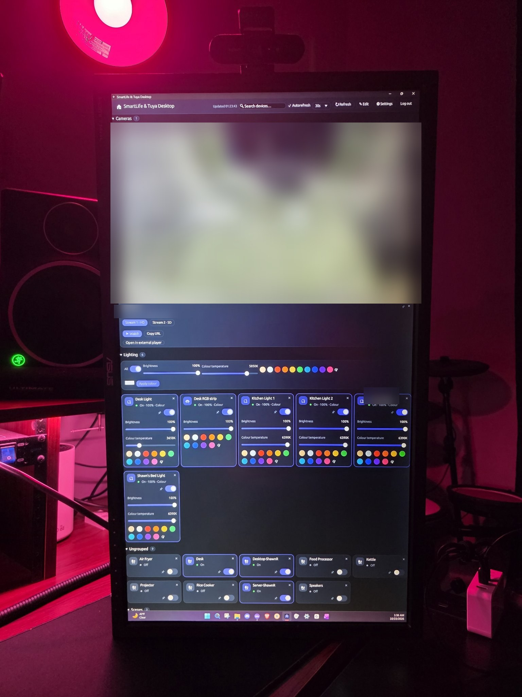

<p align="center">
  
</p>

# Homestead

A clean, modern dashboard for your **Smart Life / Tuya** devices — lights,
plugs, switches and scenes — in editions that look and behave the same:

- **Windows app** (this repo's Rust + egui program): a small native app
  with a per-user installer — no admin rights needed.
- **macOS app** (the same program, since v1.4.0): a universal
  (Apple Silicon + Intel) `.dmg`, built by CI on each release. It's
  unsigned — see [Download](#download) for the one-time Gatekeeper
  bypass.
- **Web app** (`web/Homestead.html`): a single self-contained
  HTML file — open it in any modern browser, from disk or any static host.
  No build step, no dependencies. Also live at
  [shawnrodis.github.io/Homestead](https://shawnrodis.github.io/Homestead).

> **Android?** There is no Android port, by design — Smart Life, Tuya,
> and Tapo already exist as Android apps and do the mobile job well. If
> you absolutely must have an APK version of this, wrap the web edition
> yourself with [web-to-app](https://github.com/shiaho777/web-to-app).

Both sign in to Tuya's cloud with the same account you use in the Smart Life
(or Tuya Smart) app and control devices through Tuya's own API — the same
approach as the classic Smart Life web dashboards, with the tidy,
customisable interface they always deserved.

## Screenshots

<p align="center">
  
  <br><em>On duty at a real desk — the dashboard lives on the second monitor. (Camera feed and a few details blurred for privacy.)</em>
</p>

<p align="center">
  
  <br><em>The dashboard itself — Cameras, the Lighting section with group-wide controls, and the device cards. (Camera feed blurred for privacy.)</em>
</p>

<p align="center">
  
  <br><em>Camera tiles resize — Normal, Large, or full-row Wide, as here. The feed watches the lot while the lights wait below. (Feed blurred for privacy.)</em>
</p>

## Download

**Windows:** grab `Homestead-Setup-v<version>.exe` from
[Releases](https://github.com/shawnrodis/Homestead/releases) and
run it — per-user install to `%LOCALAPPDATA%\Homestead`, with
Start Menu shortcuts and an uninstaller. No administrator rights required.

**macOS:** grab `Homestead-v<version>.dmg` from the same
release, open it, and drag the app into Applications. The build is
**unsigned** (no Apple Developer certificate), so on first launch macOS
refuses and offers to move it to Trash — don't. Instead open **System
Settings → Privacy & Security**, scroll to the Security section, and
click **Open Anyway** next to the app, then authenticate (Touch ID or
password) and confirm **Open**. After that it opens normally. (Terminal
alternative, before first launch:
`xattr -dr com.apple.quarantine /Applications/Homestead.app`;
on older macOS versions, right-click → Open does the same job.) One
universal binary covers both Apple Silicon and Intel Macs.

The installers are larger than they used to be (~100 MB) because they
bundle ffmpeg for live camera video — see [Camera video](#camera-video)
below. The web edition is the `Homestead-vX.Y.Z.html` asset on the
same release. All editions share one version number and check for updates
themselves (Settings → App updates). (Building from source is optional;
instructions below.)

## Features

- **Live dashboard** — every device and scene from your Smart Life / Tuya
  account, with autorefresh (15s–2min) and manual refresh.
- **Real controls** — on/off switches, brightness and colour-temperature
  sliders (2700K–6500K), colour swatches + full colour picker for colour
  lights and strips, one-tap scene running. Commands are optimistic and
  roll back with an error toast if Tuya rejects them.
- **Your order, your rooms** — sections sort A–Z by name by default; in
  Edit mode you can drag cards to reorder them inside a section (or use
  ↑/↓; that order sticks, and each section has a "Reset to name order"
  button), create groups, rename devices with an alias, and hide devices
  you never use. Sections appear **Cameras → Pinned → Lighting → your
  groups → Ungrouped → Scenes** by default, and in Edit mode every
  section header has ↑/↓ buttons to move the section itself — your
  arrangement is remembered.
- **Automatic Lighting & Cameras sections** — unassigned bulbs and
  strips gather in a built-in **Lighting** section, and RTSP cameras in
  a built-in **Cameras** section; assigning anything to your own group
  always wins.
- **Group controls** — the Lighting header (and any group containing a
  light) gets a master switch, average brightness / colour-temperature
  sliders and colour swatches that broadcast to every member.
- **RTSP cameras with live in-tile video** — add Tapo (or any RTSP)
  cameras in Edit mode; cards sit alongside devices with pinning,
  grouping and ordering, and the picture plays right inside the tile.
  ▶ Watch opens a big player. Camera cards are resizable in Edit mode —
  **Normal** (one cell), **Large** (two columns) or **Wide** (the full
  row) — and the Windows tile's stream resolution follows the size.
  See [Camera video](#camera-video).
- **No rate-limit nagging** — when Tuya rate-limits, the apps never show
  a warning: they quietly keep the last known states, retry commands a
  moment later, and stretch the refresh interval until things settle.
  Genuine errors (a device that's actually offline) are still reported.
- **Pinned shortcuts** — pin any device with 📌 and a full working copy
  appears in the Pinned section; the device also stays in its
  group below. Scenes always get their own Scenes section.
- **Start with the OS & tray (native apps)** — Settings →
  Startup & background can launch the app at startup (Windows: per-user
  Run key; macOS: a LaunchAgent — no admin either way) as a normal
  window, minimized to the tray / menu bar, or maximized, and can keep
  it running in the tray when the window is closed — click the icon to
  reopen it, Quit on its menu to exit. (Native-only: the web edition's
  Settings says which features are app-only and links here.)
- **Snap to a monitor (Windows app)** — the header's 🖥 Monitor menu
  moves the window onto the display you pick and maximizes it there.
  (The mechanism is Windows'; the multi-monitor desk this was built
  for is a Windows one, so the macOS app doesn't offer it.)
- **Make it yours** — Dark / Light / **Black** (true-black) themes, 7
  accent colours, comfortable / compact card density, search box.
  Everything is remembered locally.
- **Self-updating** — all editions check GitHub once a day for a newer
  release; the Windows app downloads and launches the new installer
  itself, the macOS app downloads the new `.dmg` and opens it (drag
  into Applications to replace), and the web edition offers the new
  file (and the hosted copy is always current).
- **Private by design** — your credentials go only to Tuya's own servers
  over HTTPS. "Keep me logged in" stores them only on your device
  (web: this browser's local storage; native apps: a JSON config in your
  user profile) so the app can silently re-login when the session expires.

## What's new in 2.0.0

- **Renamed to Homestead — and this one is a fresh install.** The app
  has grown well past Tuya and Smart Life (thermostat control, monitor
  handling, cameras), so it gets a name of its own. Installing 2.0.0
  does NOT touch your existing install: the old app keeps working
  side by side, with its own settings, while Homestead starts clean
  in its own folders. That means signing in to Tuya again, re-pairing
  the thermostat from scratch, and redoing pins, groups, and section
  order in the new install. Nothing is carried over, on purpose.
- **Thermostat fixes.** Temperature changes work now: setpoint writes
  are rounded to the step the thermostat itself accepts, instead of
  being rejected. Mode changes show immediately — a successful change
  is confirmed at once rather than waiting on a slow re-read. The
  status line shows the mode you set (what the wall unit shows), not
  whether the unit happens to be running right now. Status refreshes
  happen silently in the background with no "Working…" line. The
  Thermostat section now has the same collapse arrow as Cameras and
  Lighting. And Settings has a diagnostics log with Copy, so a
  thermostat problem can be pasted for debugging instead of guessed at.
- **Stricter maximized-launch monitor handling.** When the app is set
  to start maximized, it re-checks after launch that it actually
  landed on the monitor it was last on, and corrects itself if it
  didn't — still by monitor identity only, never by saved window
  position, so a disconnected display can never strand it off-screen.

## What's new in 1.6.3

- **Fixed: the thermostat tile showed 0 values (Off, 32°F) instead of
  the real state.** Two causes: the app only recognized full-length
  characteristic labels (some thermostats use short ones), and it
  trusted the first model answer for values even when that answer
  carried none. Labels are now normalized, and the app fetches the
  readings explicitly when the first answer omits them.
- **Thermostat is now its own moveable category.** It used to be
  pinned at the top of the dashboard; it now sits in the section
  order like Cameras and Lighting, with the same up/down move
  buttons in editing mode, and its position is saved. It still
  starts at the top by default, and it still shows even with no
  devices or under a search.

## What's new in 1.6.2

- **Fixed: the thermostat tile couldn't read the thermostat's state
  after pairing.** Some thermostats (including the Resideo T6 Pro)
  answer state requests in chunked pieces, which the app's reader
  didn't reassemble — so refreshes failed even though pairing had
  worked. The reader now handles chunked answers, and answers with
  no length header as a fallback. Pairing itself is unchanged from
  1.6.1.

## What's new in 1.6.1

- **Fixed: pairing with thermostats that show a fresh setup code on
  every attempt.** Some thermostats (including the Resideo T6 Pro)
  generate a new code each time pairing starts, so typing a code
  before tapping Pair could never succeed. Pairing is now two steps:
  Start pairing makes the thermostat show its fresh code, then you
  type that code and tap Finish pairing. The web edition follows the
  same two-step flow through the desktop app's bridge.
- **Small fix:** the setup-code field's hint now reads
  "e.g. 123-45-678" so it can't be mistaken for a filled-in code.

## What's new in 1.6.0

- **New: HomeKit thermostat control.** The desktop editions (Windows
  and macOS) can now discover, pair with, and control a HomeKit
  thermostat on your home network — for example a Resideo/Honeywell
  T6 Pro Smart — with a dashboard tile for indoor temperature, mode,
  setpoint, and fan. Pairing uses the code shown on the thermostat's
  screen; the pairing keys are stored in the app's config like the
  saved Tuya login, and the setup code itself is never stored.
  Control is local-network only: the app must be running on your
  home network, and your Resideo app and Alexa control keep working
  untouched.
- **Web edition: thermostat via the desktop app.** A browser page
  can't speak HomeKit directly, so the web edition talks to the
  desktop app over a loopback-only bridge on the same computer: when
  the desktop app is running, the web tile shows the same thermostat
  controls; when it isn't, the tile says so instead of showing dead
  controls.

## What's new in 1.5.0

- **Fixed: dragging the window between monitors.** On a mixed-DPI desk
  (for example a 1440p landscape monitor beside a 4K portrait one) the
  window used to grow and get stuck on the wrong monitor mid-drag.
  It now follows the drag cleanly onto the other monitor. (The
  underlying interface toolkit was also updated, which fixed a
  related bug where dashboard tiles slowly grew taller on their own.)
- **New: Maximized launches remember their monitor.** If Settings →
  Startup & background → Launch as is set to Maximized, the app
  reopens maximized on the monitor it was last on — after a reboot,
  for example — instead of wherever Windows happens to put it. If
  that display is no longer connected, it just opens maximized where
  Windows puts it. Normal and minimized launches are unchanged.

## What's new in 1.4.0

- **New: a native macOS app joins every release.** Each release now
  also ships `SmartLifeTuyaDesktop-v<version>.dmg` — a universal
  (Apple Silicon + Intel) build of this same app, assembled by CI
  from the release tag. It's the full app, not a subset: dashboard,
  cameras (with the same bundled-ffmpeg live tiles — a per-arch
  static ffmpeg rides inside the bundle), menu-bar tray with
  close-to-tray and start-at-login (a per-user LaunchAgent),
  single-instance behaviour, and the same themes and layout.
- **Unsigned, on purpose.** There's no Apple Developer certificate
  behind it, so Gatekeeper will refuse the first double-click —
  right-click → Open once (or `xattr -dr com.apple.quarantine` the
  app) and it launches normally from then on. The macOS updater
  matches: it downloads the new `.dmg` and opens it — drag into
  Applications to replace, then relaunch.
- **One honest difference:** the 🖥 **Snap to monitor** button is
  Windows-only (its move is done with Win32 calls, and the
  multi-monitor desk it was built for is a Windows desk), so it
  doesn't appear in the macOS app. The Windows-only tray balloon
  likewise has no macOS equivalent; everything else is 1:1.
- Windows and web are unchanged apart from the version — the
  Windows app just also learned to never mistake the `.dmg` for
  its own update (and vice versa).

## What's new in 1.3.2

- **Fixed: the Lighting header's colour-temperature slider
  sent 2700K to every light.** The header slider still spoke
  pre-1.3.1 units in two places: touching it collapsed its
  value to the first stop (so the readout snapped to 2700K
  mid-drag), and releasing it broadcast the raw stop *index*
  where the fan-out expects the API-scale value — which
  clamped to the minimum, 2700K, whatever stop you'd actually
  picked. It now converts the chosen stop exactly like the
  card sliders do, so a header drag sets every light to the
  stop you chose (2700 / 3000 / 4000 / 5000 / 6500K).
- **The header brightness slider was audited end-to-end** and
  already dispatched correctly (the dragged percent reaches
  every bulb, device-mapped exactly once). Both header
  sliders are now covered by tests that drive the real header
  with simulated drags — in both editions — so the wiring
  can't silently break again. (The web edition's header
  wiring was verified by the same drive test; it was not
  affected.)

## What's new in 1.3.1

- **Fixed: Snap to monitor didn't move the window.** On
  mixed-DPI setups (e.g. a 1440p main screen beside a 4K
  portrait screen) the 1.3.0 snap computed its target with the
  wrong display's scaling and the window stayed put. The move
  is now done in physical pixels with the arrival verified
  before the window maximizes — pick a display in the
  **🖥 Monitor** menu and the window really goes there.
- **Brightness sliders show 1–100% again — honestly.** The
  bulbs switch off entirely below 11%, so 11% is the true
  minimum: the slider's bottom now displays "1%" for that
  minimum instead of letting you drag a lit bulb to its
  switch-off point. A bulb sitting at its minimum reads "1%",
  full brightness reads "100%", and everything in between is
  scaled to match — in both editions, cards and group header
  alike.
- **Colour temperature snaps to five stops.** Temp sliders
  now land exactly on 2700K, 3000K, 4000K, 5000K or 6500K.
  A bulb reporting something in between (3780K, say) displays
  at the nearest stop, and group changes broadcast an exact
  stop to every light.

## What's new in 1.3.0

- **Snap to monitor (Windows app).** A new **🖥 Monitor** button
  in the header lists your displays (name, resolution,
  orientation, which one is primary, and which one the window
  is on). Pick one and the window moves there and maximizes —
  handy with multiple monitors, including portrait ones. It
  acts only when you click: nothing is saved, and how the app
  starts is unchanged. In the **web edition** (Chrome/Edge), the
  same button picks a screen for fullscreen instead — a page
  can't move its own window — and is hidden where the browser
  doesn't support that.
- **Fixed: every light showing as Off.** The service reports a
  light's on/off as text (`"true"`/`"false"`) while plugs use a
  real on/off value; the app only understood the plug format,
  so all lights read Off (and their brightness readings were
  dropped too). Lights now report correctly in both editions.
- **The colour-only strip lost its brightness slider** (e.g.
  the Desk RGB strip). Through this service it reports on/off
  and colour only — no brightness or colour temperature — so it
  no longer shows controls the service can't honour; colour and
  on/off still work, and it still joins group colour and
  on/off broadcasts. (The strip itself can dim in the official
  app; this service just doesn't expose it.)
- **Group header sliders aligned.** The colour-temperature
  slider sat a few points lower than the brightness slider in
  section headers; both tracks now share one baseline.
- **Black is the default theme** on a fresh install. If you
  already picked Dark or Light, your choice is kept.
- **Removed: window position memory (was 1.2.5).** Startup
  placement is back to the plain OS default — see the note on
  the 1.2.5 section below.

## What's new in 1.2.5

> **Removed in 1.3.0.** The placement memory below could reopen
> the window slightly off-screen (title bar out of reach) on
> some multi-monitor setups, so the feature was taken back out;
> 1.3.0 starts with the OS-default placement, and the new
> 🖥 Monitor snap (above) covers moving between displays.

- **The app remembers where its window was (Windows app).**
  Window position, size and maximized state are saved as you
  use the app, and the next launch reopens on the same monitor
  in the same place — including a second monitor in portrait.
  The saved spot is checked against the monitors you actually
  have now: if that monitor was unplugged or your layout
  changed so the window would land off-screen, it falls back
  to the default placement instead of vanishing. Starts
  minimized to the tray exactly as before — the placement
  applies underneath, so opening from the tray lands in the
  right place.

## What's new in 1.2.4

- **Fixed: "Minimized (to tray)" launches opening as a normal
  window (Windows app).** The saved Launch-as mode is now
  honoured by *every* launch, not only ones that arrive through
  the Windows-startup entry with its command-line flag: a launch
  carrying `--minimized`/`--maximized` still wins for that launch,
  but an ordinary launch (Start Menu, shortcut — including
  Windows' automatic relaunch of running apps at sign-in, which
  passes no flag at all) now falls back to the saved mode. And
  while a minimized launch hasn't been explicitly shown from the
  tray, the app re-asserts its hidden state every frame, so it
  can neither flash on screen nor stick open. Regression-tested
  for the arg-less launch case.

## What's new in 1.2.3

- **Fixed: the Lighting header's controls tangling (Windows app).**
  The Brightness and Colour temperature label/slider pairs in a
  section header no longer interleave or staircase, and the colour
  swatches stay on their own line: each control group is now one
  solid mini-panel, and whole groups wrap to the next line on
  narrow windows — never their insides. (The web header already
  laid its groups out this way.)
- **Fixed: device names still truncating to "De…" / "Kit…"
  (Windows app).** At the card widths the grid actually produces,
  the pin + toggle + hide buttons simply leave too little room
  for a full name on the same line — so on narrow cards they now
  move to their own line under the name (the hide button does the
  same on scene cards), and names like "Kitchen Light 1" render
  in full at every window size. Proven by a new render test that
  reads back the text the app actually draws, including after a
  minimized (tiny-window) start followed by a resize. The web
  edition's headers wrap the same way.
- **Fixed: tray Open never working and Quit only working while
  the window was open (Windows app).** Tray clicks were only
  being read when the app drew a frame — and a hidden window
  draws none, so the clicks sat unread forever. A dedicated tray
  thread now receives them: Open restores the window directly
  (even from the tray, even minimized), and Quit runs the real
  exit — drop the icon, stop camera streams, save, close. A
  second launch while hidden also brings the window back
  reliably now.
- **Fixed: RGB strip cards had no brightness slider (both
  editions).** A colour-only strip can dim — it just does it
  through its colour command — so it (and the Lighting header)
  now gets a brightness slider that rides the colour's
  brightness. Colour temperature stays hidden for strips: they
  genuinely can't do it.
- **Brightness now goes down to 1% (both editions).** The slider
  floor was 11%; cards and group controls now reach 1%.

## What's new in 1.2.2

- **Fixed: system tray (Windows app).** Launching the app while it was
  already running hidden in the tray no longer starts a second copy —
  the app is single-instance now: a repeat launch just brings the
  running window back (visible, un-minimized, focused) and exits.
  That also ends the multiplying tray icons, and the tray's Open /
  Quit and left-click restore work reliably (tray events are pumped
  on a short heartbeat while the window is hidden, and Quit removes
  the icon before exiting).
- **Fixed: camera tiles stuck on "Feed unavailable".** A tile whose
  camera address changed (e.g. DHCP gave it a new IP) restarts its
  stream from the current settings immediately; retries back off
  2s → 4s → 8s at most (was up to 15s) and reset the moment the
  window is focused again, you click the tile or Watch, or the big
  player connects. "Feed unavailable" is now a **Retry** button, and
  after repeated failures the tile shows why in small print (e.g.
  "Connection refused", "401 Unauthorized"). Opening the big player
  also pauses that camera's tile stream — Tapo cameras only allow
  about two concurrent streams — and the tile resumes when it closes.
- **Fixed: brightness slider vanishing from light cards (both
  editions).** A refresh payload that reports placeholder values
  (brightness missing, colour temperature 0) no longer wipes the
  controls: sliders follow what a light *can* do, values keep their
  last-known readings through thin refreshes, lights no longer all
  snap to 2700K, and the Lighting header keeps both sliders too.
- **Fixed: names truncating on wide cards (Windows app).** Device,
  camera and scene names now lay out against the card's real width —
  the space reserved for the pin/toggle/hide buttons was over-counted
  — so wide cards show full names again.

## What's new in 1.2.1

- **Fixed: camera Edit/Delete buttons that didn't respond in Edit mode**
  (Windows app). A press on a card immediately started a drag, which
  hid the card mid-click — so the release never landed on its buttons.
  Drags now start only after ~8px of pointer travel, and clicks always
  land. Camera ids are also unique-generated now (they were bare
  timestamps) with automatic repair of any duplicates from older
  versions, and edit/delete report honestly instead of failing
  silently.
- **Resizable camera cards** — Normal / Large / Wide per camera (Edit
  mode), in both editions; the Windows tile stream resolution follows
  the size.
- **Sections can be reordered** — ↑/↓ on every section header in Edit
  mode, persisted; and the default order is now **Cameras first**:
  Cameras → Pinned → Lighting → groups → Ungrouped → Scenes.
- **Startup & tray (Windows app)** — Start-with-Windows with a
  Normal / Minimized / Maximized launch choice, and an optional
  keep-running-in-the-tray mode with a tray icon (Open / Quit).
- **Painted play/pause icon** on camera tiles (the ⏸ glyph rendered
  as a blob through the fallback font) — now two drawn bars / a
  triangle in a tidy chip.
- **Web edition note** — Settings (and Help) now say plainly which
  features are Windows-app-only, with a "Get the Windows app" link.

## Camera video

Camera tiles play **live video in place** — no external player needed:

- **Windows app:** a bundled copy of **FFmpeg** decodes each camera's
  RTSP stream. Tiles use the low-bandwidth stream (Tapo Stream 2) at a
  small size; clicking a tile (or ▶ Watch) opens the big in-app player
  at the quality picked on the card, with a quality switch. If a feed
  drops, the tile quietly retries on its own. The app looks for ffmpeg
  beside its own exe first (that's where the installer puts it), then
  at the optional path in Settings → Stream gateway & cameras, then on
  `PATH`; if none is found, previews turn off and Watch falls back to
  an external player (VLC by default) or a configured stream gateway.
- **Web edition:** browsers can't decode RTSP, so when a stream gateway
  (go2rtc / MediaMTX) is configured in Settings, tiles embed the
  gateway's feed (go2rtc MJPEG / MediaMTX HLS) and Watch plays in-page;
  without a gateway, Watch hands the stream to a player app as before.

**FFmpeg attribution.** The Windows installer bundles `ffmpeg.exe`
from the [gyan.dev](https://www.gyan.dev/ffmpeg/builds/) **FFmpeg
7.1.1 essentials** static build
([source](https://github.com/GyanD/codexffmpeg/releases/tag/7.1.1)).
FFmpeg is licensed under the **GNU GPL v3** — its full license text
ships in the install folder (`licenses\FFmpeg-LICENSE.txt`, and in
this repo under `licenses/`) — which is compatible with this project's
own GPL-3.0. Bundling it is why the installer is ~100 MB.

## Which region / platform?

Pick the **region where your Smart Life account was registered** (US / EU /
CN) and the app you use (**Smart Life** or **Tuya Smart**). The wrong region
is the most common cause of "login failed". US and EU accounts connect
directly; China-region traffic is routed through a community CORS proxy in
the web edition's "Auto" mode (configurable in Settings → Connection).

## Build from source

On Windows (install Rust via [rustup](https://rustup.rs) first):

```powershell
cargo build --release
```

Cross-compile from Linux (what the releases are built with):

```bash
# mingw-w64 provides the linker and windres
sudo apt install mingw-w64 nsis
rustup target add x86_64-pc-windows-gnu
cargo build --release --target x86_64-pc-windows-gnu
# installer:
cp target/x86_64-pc-windows-gnu/release/Homestead.exe installer/
cd installer && makensis installer.nsi
```

The build script generates a small `.rc` (exe icon +
`assets/Homestead.manifest`), compiles it with windres and links
the result directly, embedding the icon and the asInvoker manifest. Settings are stored at
`%APPDATA%\Homestead\config.json`.

## The two editions stay in step

Both editions share one design system — same layout, colours, cards and
behaviour rules — documented in [DESIGN.md](DESIGN.md). The web edition is
at `web/Homestead.html`; it talks to the same Tuya API with the
same value scales and control payloads as the Windows app.

## Project layout

```
Homestead/
├── src/main.rs            # the whole Windows app (egui)
├── build.rs               # embeds icon + admin-free manifest via windres
├── assets/
│   ├── Homestead.ico      # exe icon
│   ├── Homestead.manifest # asInvoker manifest
│   ├── icon.png                      # runtime / README icon
│   ├── ffmpeg.exe                    # bundled FFmpeg 7.1.1 (GPL v3) for live camera video
│   └── fonts/                        # embedded glyph fallbacks (egui)
├── licenses/
│   └── FFmpeg-LICENSE.txt            # FFmpeg's GPL v3 license text
├── web/
│   └── Homestead.html   # the web edition (single file)
├── installer/
│   └── installer.nsi                 # per-user NSIS installer
├── DESIGN.md              # shared design tokens for both editions
└── Cargo.toml
```

## License

GPL-3.0 — see [LICENSE](LICENSE). Copyright (c) 2026 Shawn Rodis.
