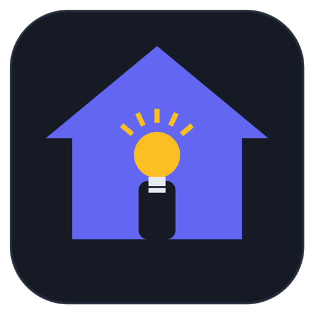
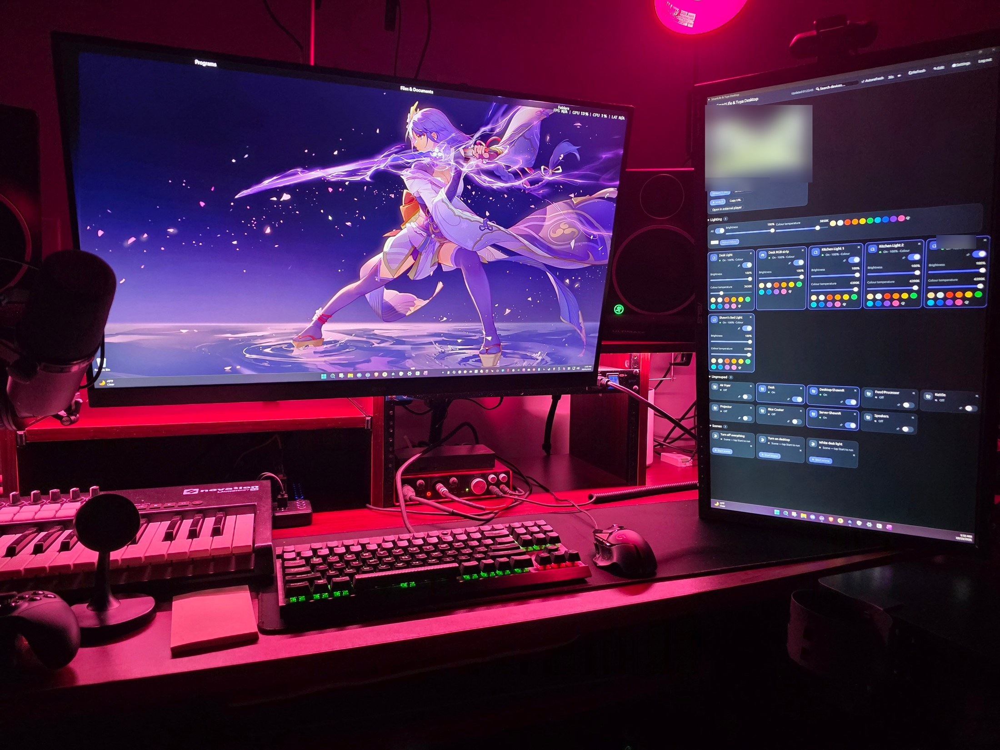
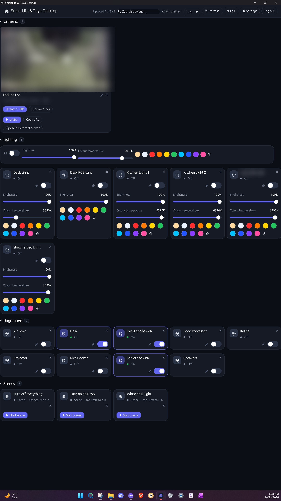

<p align="center">
  
</p>

# SmartLife & Tuya Desktop

A clean, modern dashboard for your **Smart Life / Tuya** devices — lights,
plugs, switches and scenes — in two editions that look and behave the same:

- **Windows app** (this repo's Rust + egui program): a small native app
  with a per-user installer — no admin rights needed.
- **Web app** (`web/SmartLife_Tuya_Desktop.html`): a single self-contained
  HTML file — open it in any modern browser, from disk or any static host.
  No build step, no dependencies. Also live at
  [shawnrodis.github.io/SmartLifeTuyaDesktop](https://shawnrodis.github.io/SmartLifeTuyaDesktop).

Both sign in to Tuya's cloud with the same account you use in the Smart Life
(or Tuya Smart) app and control devices through Tuya's own API — the same
approach as the classic Smart Life web dashboards, with the tidy,
customisable interface they always deserved.

## Screenshots

<p align="center">
  
  <br><em>On duty at a real desk — the dashboard lives on the second monitor. (Camera feed and a few details blurred for privacy.)</em>
</p>

<p align="center">
  
  <br><em>The dashboard itself — Cameras, the Lighting section with group-wide controls, and the device cards. (Camera feed blurred for privacy.)</em>
</p>

## Download (Windows)

Grab `SmartLifeTuyaDesktop-Setup-v1.2.1.exe` from
[Releases](https://github.com/shawnrodis/SmartLifeTuyaDesktop/releases) and
run it — per-user install to `%LOCALAPPDATA%\SmartLifeTuyaDesktop`, with
Start Menu shortcuts and an uninstaller. No administrator rights required.
The installer is larger than it used to be (~100 MB) because it bundles
ffmpeg for live camera video — see [Camera video](#camera-video) below.
The web edition is the `SmartLife_Tuya_Desktop.html` asset on the same
release. Both editions share one version number and check for updates
themselves (Settings → App updates). (Building from source is optional;
instructions below.)

## Features

- **Live dashboard** — every device and scene from your Smart Life / Tuya
  account, with autorefresh (15s–2min) and manual refresh.
- **Real controls** — on/off switches, brightness and colour-temperature
  sliders (2700K–6500K), colour swatches + full colour picker for colour
  lights and strips, one-tap scene running. Commands are optimistic and
  roll back with an error toast if Tuya rejects them.
- **Your order, your rooms** — sections sort A–Z by name by default; in
  Edit mode you can drag cards to reorder them inside a section (or use
  ↑/↓; that order sticks, and each section has a "Reset to name order"
  button), create groups, rename devices with an alias, and hide devices
  you never use. Sections appear **Cameras → Pinned → Lighting → your
  groups → Ungrouped → Scenes** by default, and in Edit mode every
  section header has ↑/↓ buttons to move the section itself — your
  arrangement is remembered.
- **Automatic Lighting & Cameras sections** — unassigned bulbs and
  strips gather in a built-in **Lighting** section, and RTSP cameras in
  a built-in **Cameras** section; assigning anything to your own group
  always wins.
- **Group controls** — the Lighting header (and any group containing a
  light) gets a master switch, average brightness / colour-temperature
  sliders and colour swatches that broadcast to every member.
- **RTSP cameras with live in-tile video** — add Tapo (or any RTSP)
  cameras in Edit mode; cards sit alongside devices with pinning,
  grouping and ordering, and the picture plays right inside the tile.
  ▶ Watch opens a big player. Camera cards are resizable in Edit mode —
  **Normal** (one cell), **Large** (two columns) or **Wide** (the full
  row) — and the Windows tile's stream resolution follows the size.
  See [Camera video](#camera-video).
- **No rate-limit nagging** — when Tuya rate-limits, the apps never show
  a warning: they quietly keep the last known states, retry commands a
  moment later, and stretch the refresh interval until things settle.
  Genuine errors (a device that's actually offline) are still reported.
- **Pinned shortcuts** — pin any device with 📌 and a full working copy
  appears in the Pinned section; the device also stays in its
  group below. Scenes always get their own Scenes section.
- **Start with Windows & system tray (Windows app)** — Settings →
  Startup & background can launch the app with Windows (per-user, no
  admin) as a normal window, minimized to the tray, or maximized, and
  can keep it running in the system tray when the window is closed —
  left-click the tray icon to reopen it, right-click → Quit to exit.
  (Windows-only: the web edition's Settings says which features are
  Windows-app-only and links here.)
- **Make it yours** — Dark / Light / **Black** (true-black) themes, 7
  accent colours, comfortable / compact card density, search box.
  Everything is remembered locally.
- **Self-updating** — both editions check GitHub once a day for a newer
  release; the Windows app downloads and launches the new installer
  itself, the web edition offers the new file (and the hosted copy is
  always current).
- **Private by design** — your credentials go only to Tuya's own servers
  over HTTPS. "Keep me logged in" stores them only on your device
  (web: this browser's local storage; Windows: a JSON config in your user
  profile) so the app can silently re-login when the session expires.

## What's new in 1.2.4

- **Fixed: "Minimized (to tray)" launches opening as a normal
  window (Windows app).** The saved Launch-as mode is now
  honoured by *every* launch, not only ones that arrive through
  the Windows-startup entry with its command-line flag: a launch
  carrying `--minimized`/`--maximized` still wins for that launch,
  but an ordinary launch (Start Menu, shortcut — including
  Windows' automatic relaunch of running apps at sign-in, which
  passes no flag at all) now falls back to the saved mode. And
  while a minimized launch hasn't been explicitly shown from the
  tray, the app re-asserts its hidden state every frame, so it
  can neither flash on screen nor stick open. Regression-tested
  for the arg-less launch case.

## What's new in 1.2.3

- **Fixed: the Lighting header's controls tangling (Windows app).**
  The Brightness and Colour temperature label/slider pairs in a
  section header no longer interleave or staircase, and the colour
  swatches stay on their own line: each control group is now one
  solid mini-panel, and whole groups wrap to the next line on
  narrow windows — never their insides. (The web header already
  laid its groups out this way.)
- **Fixed: device names still truncating to "De…" / "Kit…"
  (Windows app).** At the card widths the grid actually produces,
  the pin + toggle + hide buttons simply leave too little room
  for a full name on the same line — so on narrow cards they now
  move to their own line under the name (the hide button does the
  same on scene cards), and names like "Kitchen Light 1" render
  in full at every window size. Proven by a new render test that
  reads back the text the app actually draws, including after a
  minimized (tiny-window) start followed by a resize. The web
  edition's headers wrap the same way.
- **Fixed: tray Open never working and Quit only working while
  the window was open (Windows app).** Tray clicks were only
  being read when the app drew a frame — and a hidden window
  draws none, so the clicks sat unread forever. A dedicated tray
  thread now receives them: Open restores the window directly
  (even from the tray, even minimized), and Quit runs the real
  exit — drop the icon, stop camera streams, save, close. A
  second launch while hidden also brings the window back
  reliably now.
- **Fixed: RGB strip cards had no brightness slider (both
  editions).** A colour-only strip can dim — it just does it
  through its colour command — so it (and the Lighting header)
  now gets a brightness slider that rides the colour's
  brightness. Colour temperature stays hidden for strips: they
  genuinely can't do it.
- **Brightness now goes down to 1% (both editions).** The slider
  floor was 11%; cards and group controls now reach 1%.

## What's new in 1.2.2

- **Fixed: system tray (Windows app).** Launching the app while it was
  already running hidden in the tray no longer starts a second copy —
  the app is single-instance now: a repeat launch just brings the
  running window back (visible, un-minimized, focused) and exits.
  That also ends the multiplying tray icons, and the tray's Open /
  Quit and left-click restore work reliably (tray events are pumped
  on a short heartbeat while the window is hidden, and Quit removes
  the icon before exiting).
- **Fixed: camera tiles stuck on "Feed unavailable".** A tile whose
  camera address changed (e.g. DHCP gave it a new IP) restarts its
  stream from the current settings immediately; retries back off
  2s → 4s → 8s at most (was up to 15s) and reset the moment the
  window is focused again, you click the tile or Watch, or the big
  player connects. "Feed unavailable" is now a **Retry** button, and
  after repeated failures the tile shows why in small print (e.g.
  "Connection refused", "401 Unauthorized"). Opening the big player
  also pauses that camera's tile stream — Tapo cameras only allow
  about two concurrent streams — and the tile resumes when it closes.
- **Fixed: brightness slider vanishing from light cards (both
  editions).** A refresh payload that reports placeholder values
  (brightness missing, colour temperature 0) no longer wipes the
  controls: sliders follow what a light *can* do, values keep their
  last-known readings through thin refreshes, lights no longer all
  snap to 2700K, and the Lighting header keeps both sliders too.
- **Fixed: names truncating on wide cards (Windows app).** Device,
  camera and scene names now lay out against the card's real width —
  the space reserved for the pin/toggle/hide buttons was over-counted
  — so wide cards show full names again.

## What's new in 1.2.1

- **Fixed: camera Edit/Delete buttons that didn't respond in Edit mode**
  (Windows app). A press on a card immediately started a drag, which
  hid the card mid-click — so the release never landed on its buttons.
  Drags now start only after ~8px of pointer travel, and clicks always
  land. Camera ids are also unique-generated now (they were bare
  timestamps) with automatic repair of any duplicates from older
  versions, and edit/delete report honestly instead of failing
  silently.
- **Resizable camera cards** — Normal / Large / Wide per camera (Edit
  mode), in both editions; the Windows tile stream resolution follows
  the size.
- **Sections can be reordered** — ↑/↓ on every section header in Edit
  mode, persisted; and the default order is now **Cameras first**:
  Cameras → Pinned → Lighting → groups → Ungrouped → Scenes.
- **Startup & tray (Windows app)** — Start-with-Windows with a
  Normal / Minimized / Maximized launch choice, and an optional
  keep-running-in-the-tray mode with a tray icon (Open / Quit).
- **Painted play/pause icon** on camera tiles (the ⏸ glyph rendered
  as a blob through the fallback font) — now two drawn bars / a
  triangle in a tidy chip.
- **Web edition note** — Settings (and Help) now say plainly which
  features are Windows-app-only, with a "Get the Windows app" link.

## Camera video

Camera tiles play **live video in place** — no external player needed:

- **Windows app:** a bundled copy of **FFmpeg** decodes each camera's
  RTSP stream. Tiles use the low-bandwidth stream (Tapo Stream 2) at a
  small size; clicking a tile (or ▶ Watch) opens the big in-app player
  at the quality picked on the card, with a quality switch. If a feed
  drops, the tile quietly retries on its own. The app looks for ffmpeg
  beside its own exe first (that's where the installer puts it), then
  at the optional path in Settings → Stream gateway & cameras, then on
  `PATH`; if none is found, previews turn off and Watch falls back to
  an external player (VLC by default) or a configured stream gateway.
- **Web edition:** browsers can't decode RTSP, so when a stream gateway
  (go2rtc / MediaMTX) is configured in Settings, tiles embed the
  gateway's feed (go2rtc MJPEG / MediaMTX HLS) and Watch plays in-page;
  without a gateway, Watch hands the stream to a player app as before.

**FFmpeg attribution.** The Windows installer bundles `ffmpeg.exe`
from the [gyan.dev](https://www.gyan.dev/ffmpeg/builds/) **FFmpeg
7.1.1 essentials** static build
([source](https://github.com/GyanD/codexffmpeg/releases/tag/7.1.1)).
FFmpeg is licensed under the **GNU GPL v3** — its full license text
ships in the install folder (`licenses\FFmpeg-LICENSE.txt`, and in
this repo under `licenses/`) — which is compatible with this project's
own GPL-3.0. Bundling it is why the installer is ~100 MB.

## Which region / platform?

Pick the **region where your Smart Life account was registered** (US / EU /
CN) and the app you use (**Smart Life** or **Tuya Smart**). The wrong region
is the most common cause of "login failed". US and EU accounts connect
directly; China-region traffic is routed through a community CORS proxy in
the web edition's "Auto" mode (configurable in Settings → Connection).

## Build from source

On Windows (install Rust via [rustup](https://rustup.rs) first):

```powershell
cargo build --release
```

Cross-compile from Linux (what the releases are built with):

```bash
# mingw-w64 provides the linker and windres
sudo apt install mingw-w64 nsis
rustup target add x86_64-pc-windows-gnu
cargo build --release --target x86_64-pc-windows-gnu
# installer:
cp target/x86_64-pc-windows-gnu/release/SmartLifeTuyaDesktop.exe installer/
cd installer && makensis installer.nsi
```

The build script generates a small `.rc` (exe icon +
`assets/SmartLifeTuyaDesktop.manifest`), compiles it with windres and links
the result directly, embedding the icon and the asInvoker manifest. Settings are stored at
`%APPDATA%\SmartLifeTuyaDesktop\config.json`.

## The two editions stay in step

Both editions share one design system — same layout, colours, cards and
behaviour rules — documented in [DESIGN.md](DESIGN.md). The web edition is
at `web/SmartLife_Tuya_Desktop.html`; it talks to the same Tuya API with the
same value scales and control payloads as the Windows app.

## Project layout

```
SmartLifeTuyaDesktop/
├── src/main.rs            # the whole Windows app (egui)
├── build.rs               # embeds icon + admin-free manifest via windres
├── assets/
│   ├── SmartLifeTuyaDesktop.ico      # exe icon
│   ├── SmartLifeTuyaDesktop.manifest # asInvoker manifest
│   ├── icon.png                      # runtime / README icon
│   ├── ffmpeg.exe                    # bundled FFmpeg 7.1.1 (GPL v3) for live camera video
│   └── fonts/                        # embedded glyph fallbacks (egui)
├── licenses/
│   └── FFmpeg-LICENSE.txt            # FFmpeg's GPL v3 license text
├── web/
│   └── SmartLife_Tuya_Desktop.html   # the web edition (single file)
├── installer/
│   └── installer.nsi                 # per-user NSIS installer
├── DESIGN.md              # shared design tokens for both editions
└── Cargo.toml
```

## License

GPL-3.0 — see [LICENSE](LICENSE). Copyright (c) 2026 Shawn Rodis.
